# 信用残ウォッチ

> 信用残 **11/19 申込み分** ・ 株価 11/20 終値 ・ 更新 11/22 14:09

## 地合い

**引力：下向き**（G250 5日-12%・日経 5日-8%・NASDAQ -5.3%・VIX 36）

**温度感：冷えている（悲観）**

| ものさし | 値 | 目安 |
|---|--:|---|
| 信⁠用⁠損⁠益⁠率 | -⁠1⁠8⁠.⁠8⁠% | 冷⁠え⁠て⁠い⁠る |
| └⁠以⁠前 | -⁠1⁠5⁠.⁠6⁠% | 1⁠1⁠/⁠1⁠3⁠申⁠込 |
| └⁠範⁠囲 | 1⁠1⁠/⁠1⁠9⁠申⁠込 | 上⁠位⁠5⁠0⁠0・買⁠残⁠の⁠8⁠2⁠% |
| **日経平均** |  |  |
| 2⁠5⁠日⁠乖⁠離 | -⁠8⁠.⁠5⁠% | 売⁠ら⁠れ⁠す⁠ぎ |
| 7⁠5⁠日⁠乖⁠離 | -⁠1⁠2⁠.⁠8⁠% | 線⁠の⁠下 |
| R⁠S⁠I | 3⁠1 | 普⁠通 |
| B⁠B | -⁠2⁠σ⁠割⁠れ | 売⁠ら⁠れ⁠す⁠ぎ |
| 1⁠3⁠週⁠線 | 下 | 怪⁠し⁠い（⁠利⁠確⁠早⁠め⁠） |
| 高⁠値⁠か⁠ら | -⁠2⁠2⁠.⁠0⁠% | 高⁠値 7⁠2⁠,⁠3⁠6⁠6 |

**向かい風が強い**　🟢追い風 1・🔴向かい風 11・🟡注意 0・⚪中立 3

**米国**（11/20 終値）

| 指標 | 終値 | 前日比 | |
|---|--:|--:|:-:|
| S&P500 | 6,910 | -3.7% | 🔴 |
| NASDAQ | 22,618 | -5.3% | 🔴 |
| ダウ | 48,147 | -1.9% | 🔴 |
| 半導体（SOX） | 8,409 | -10.7% | 🔴 |
| S&P500先物 | 6,935 | -3.6% | 🔴 |
| 米小型株（ラッセル2000） | 256.6 | -2.9% | 🔴 |
| VIX（恐怖指数） | 35.89 | +26.2% | 🔴 |
| 米10年金利 | 4.91% | -0.14pt | 🟢 |

**日本**（11/20 終値）

| 指標 | 終値 | 前日比 | |
|---|--:|--:|:-:|
| 日経平均 | 56,437 | -5.1% | 🔴 |
| 日経先物（CME） | 54,555 | -5.8% | 🔴 |
| グロース250（ETF） | 512.0 | -5.3% | 🔴 |
| TOPIX（ETF） | 386.2 | -4.0% | 🔴 |

**その他**（11/22 終値）

| 指標 | 終値 | 前日比 | |
|---|--:|--:|:-:|
| 原油（WTI） | 83.41 | +0.2% | ⚪ |
| ドル円 | 159.71 | +0.2% | ⚪ |
| ビットコイン | 58,984 | +0.3% | ⚪ |

- VIX（恐怖指数）：恐怖
- 日経平均：週足: 13週線の下（週足で怪しい→利確早め）
- ドル円：円安
- 25日線の下：S&P500・NASDAQ・ダウ・半導体（SOX）・S&P500先物・米小型株（ラッセル2000）・日経平均・日経先物（CME）・グロース250（ETF）・TOPIX（ETF）

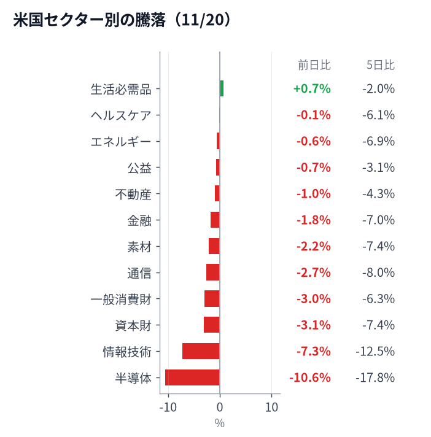

- 強い: 住宅建設 +0.4%・保険 -0.1%・石油・ガス開発 -1.1%
- 弱い: 半導体 -10.5%・暗号資産関連 -9.3%・太陽光 -7.3%

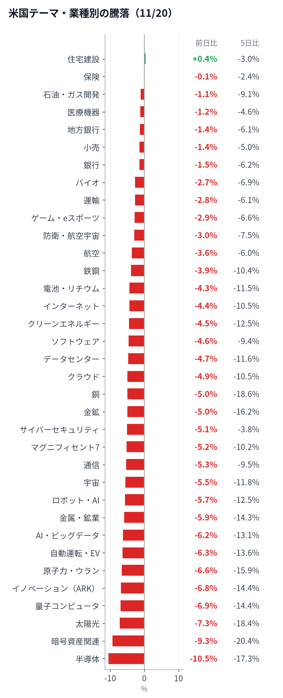

セクター・テーマの数値（分類別）

| 分類 | 名前（ETF） | 前日比 | 5日比 |
|---|---|--:|--:|
| セクター | 生活必需品（XLP） | +0.7% | -2.0% |
| セクター | ヘルスケア（XLV） | -0.1% | -6.1% |
| セクター | エネルギー（XLE） | -0.6% | -6.9% |
| セクター | 公益（XLU） | -0.7% | -3.1% |
| セクター | 不動産（XLRE） | -1.0% | -4.3% |
| セクター | 金融（XLF） | -1.8% | -7.0% |
| セクター | 素材（XLB） | -2.2% | -7.4% |
| セクター | 通信（XLC） | -2.7% | -8.0% |
| セクター | 一般消費財（XLY） | -3.0% | -6.3% |
| セクター | 資本財（XLI） | -3.1% | -7.4% |
| セクター | 情報技術（XLK） | -7.3% | -12.5% |
| セクター | 半導体（SMH） | -10.6% | -17.8% |
| テック | ゲーム・eスポーツ（ESPO） | -2.9% | -6.6% |
| テック | インターネット（FDN） | -4.4% | -10.5% |
| テック | ソフトウェア（IGV） | -4.6% | -9.4% |
| テック | データセンター（DTCR） | -4.7% | -11.6% |
| テック | クラウド（SKYY） | -4.9% | -10.5% |
| テック | サイバーセキュリティ（CIBR） | -5.1% | -3.8% |
| テック | マグニフィセント7（MAGS） | -5.2% | -10.2% |
| テック | 通信（XTL） | -5.3% | -9.5% |
| テック | ロボット・AI（BOTZ） | -5.7% | -12.5% |
| テック | AI・ビッグデータ（AIQ） | -6.2% | -13.1% |
| テック | イノベーション（ARK）（ARKK） | -6.8% | -14.4% |
| テック | 量子コンピュータ（QTUM） | -6.9% | -14.4% |
| テック | 半導体（SOXX） | -10.5% | -17.3% |
| 宇宙・防衛 | 防衛・航空宇宙（ITA） | -3.0% | -7.5% |
| 宇宙・防衛 | 宇宙（UFO） | -5.5% | -11.8% |
| 乗り物 | 運輸（IYT） | -2.8% | -6.1% |
| 乗り物 | 航空（JETS） | -3.6% | -6.0% |
| 乗り物 | 電池・リチウム（LIT） | -4.3% | -11.5% |
| 乗り物 | 自動運転・EV（DRIV） | -6.3% | -13.6% |
| エネルギー | 石油・ガス開発（XOP） | -1.1% | -9.1% |
| エネルギー | クリーンエネルギー（ICLN） | -4.5% | -12.5% |
| エネルギー | 原子力・ウラン（URA） | -6.6% | -15.9% |
| エネルギー | 太陽光（TAN） | -7.3% | -18.4% |
| 素材 | 鉄鋼（SLX） | -3.9% | -10.4% |
| 素材 | 銅（COPX） | -5.0% | -18.6% |
| 素材 | 金鉱（GDX） | -5.0% | -16.2% |
| 素材 | 金属・鉱業（XME） | -5.9% | -14.3% |
| ヘルスケア | 医療機器（IHI） | -1.2% | -4.6% |
| ヘルスケア | バイオ（XBI） | -2.7% | -6.9% |
| 金融 | 保険（KIE） | -0.1% | -2.4% |
| 金融 | 地方銀行（KRE） | -1.4% | -6.1% |
| 金融 | 銀行（KBE） | -1.5% | -6.2% |
| 金融 | 暗号資産関連（BITQ） | -9.3% | -20.4% |
| 消費・住宅 | 住宅建設（ITB） | +0.4% | -3.0% |
| 消費・住宅 | 小売（XRT） | -1.4% | -5.0% |

## 銘柄

### イオレ（2334）　487円

> 地合いの引力は下向き、セクターも向かい風。PERなど表面上はやや割高。上値の重しに株数の増加。需給は上げで買残が増え、戻り売りが控えている。下の転換点 482円（-1.0%）に到達・接近。地合いが悪い日に逆行陽線。

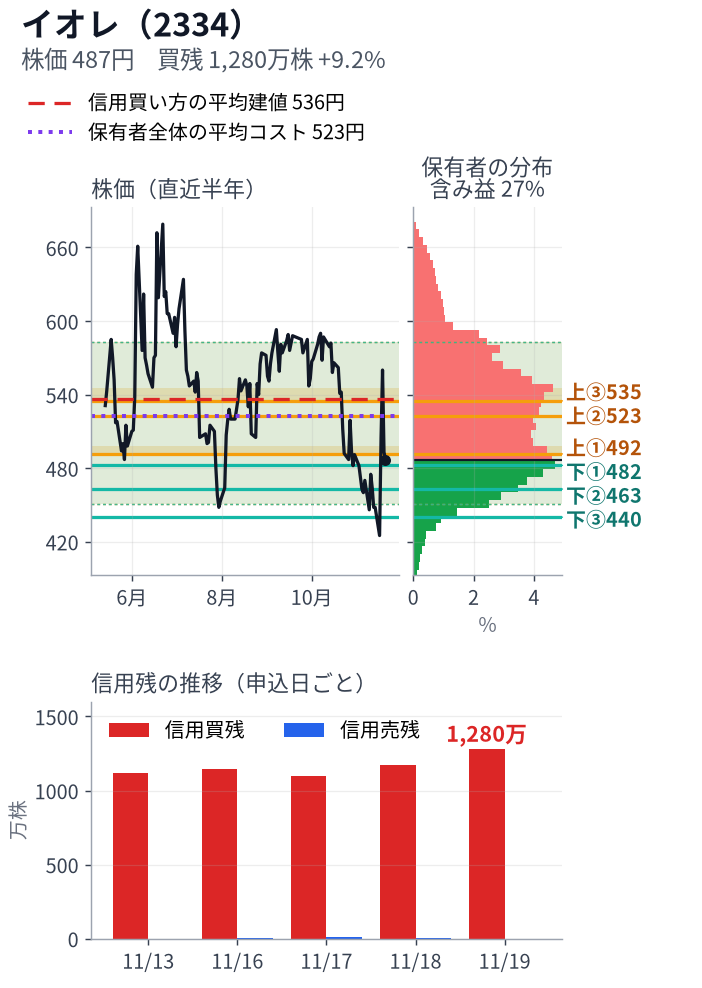

| 分析 | 　 |
|---|---|
| 引⁠力 | **下⁠向⁠き**（⁠G⁠2⁠5⁠0 5⁠日⁠-⁠1⁠2⁠%・日⁠経 5⁠日⁠-⁠8⁠%・N⁠A⁠S⁠D⁠A⁠Q -⁠5⁠.⁠3⁠%・V⁠I⁠X 3⁠6⁠） |
| セ⁠ク⁠タ⁠ー | イ⁠ン⁠タ⁠ー⁠ネ⁠ッ⁠ト -⁠4⁠.⁠4⁠%（⁠5⁠日⁠-⁠1⁠1⁠%⁠） |
| P⁠E⁠R・P⁠B⁠R | 赤⁠字・4⁠.⁠6⁠7⁠倍 |
| 表⁠面⁠の⁠評⁠価 | **や⁠や⁠割⁠高（⁠赤⁠字⁠の⁠た⁠め P⁠B⁠R 4⁠.⁠7⁠倍⁠）** |
| 上⁠値⁠の⁠重⁠し | 株⁠数 +⁠3⁠6⁠%⁠/⁠年（⁠希⁠薄⁠化⁠） |
| 新⁠規⁠材⁠料 | 直⁠近⁠3⁠0⁠日⁠な⁠し |
| 下⁠方⁠向⁠圧⁠力 | **上⁠値⁠に⁠重⁠し** |
| 中⁠身 | 上⁠げ⁠で⁠買⁠残⁠が⁠増⁠え⁠る（⁠戻⁠り⁠売⁠り⁠予⁠備⁠軍⁠） |
| 5⁠日⁠の⁠変⁠化 | 株⁠価⁠+⁠9⁠%・買⁠残⁠+⁠1⁠4⁠%・出⁠来⁠高⁠5⁠.⁠0⁠倍 |
| 本⁠尊⁠の⁠気⁠配 | **見⁠え⁠な⁠い（⁠1⁠/⁠7⁠）** |
| └⁠逆⁠行 | 1⁠0⁠日⁠で⁠G⁠2⁠5⁠0⁠よ⁠り⁠+⁠1⁠4⁠%・逆⁠行⁠陽⁠線⁠3⁠回 |
| 反⁠発⁠サ⁠イ⁠ン | **逆⁠行⁠陽⁠線** |
| 直⁠近⁠3⁠日 | 1⁠1⁠/⁠1⁠8⁠◎⁠逆 1⁠1⁠/⁠1⁠9⁠× 1⁠1⁠/⁠2⁠0⁠△⁠逆 |
| 信⁠用⁠買⁠残 | 1⁠,⁠2⁠8⁠0⁠万⁠株（⁠+⁠9⁠.⁠2⁠%⁠） |
| 上⁠場⁠株⁠数⁠比 | **2⁠9⁠.⁠7⁠%** |
| 信⁠用⁠建⁠値 | 5⁠3⁠6⁠円（⁠-⁠9⁠.⁠2⁠%⁠） |
| 含⁠み⁠益⁠保⁠有 | 2⁠7⁠% |

| 位置 | 価格 | 距離 | 根拠 |
|---|--:|--:|---|
| 上⁠③ | 5⁠3⁠5 | +⁠1⁠0⁠% | 7⁠5⁠日⁠線・信⁠用⁠建⁠値・厚⁠い⁠帯 4⁠5⁠1⁠〜⁠5⁠8⁠3（⁠8⁠2⁠%⁠） |
| 上⁠② | 5⁠2⁠3 | +⁠7⁠% | 平⁠均⁠コ⁠ス⁠ト |
| 上⁠① | 4⁠9⁠2 | +⁠0⁠.⁠9⁠% | E⁠M⁠A⁠2⁠0・2⁠5⁠日⁠線・戻⁠り⁠高⁠値 |
| **株価** | **487** | | |
| 下⁠① | 4⁠8⁠2 | -⁠1⁠.⁠0⁠% | 厚⁠い⁠帯 4⁠5⁠1⁠〜⁠5⁠8⁠3（⁠8⁠2⁠%⁠）・フ⁠ィ⁠ボ⁠5⁠0⁠% |
| 下⁠② | 4⁠6⁠3 | -⁠5⁠% | 反⁠発⁠安⁠値⁠×⁠2 |
| 下⁠③ | 4⁠4⁠0 | -⁠1⁠0⁠% | 反⁠発⁠安⁠値 |

| 買残 | 万株 | 直近 | 万株 |
|---|--:|---|--:|
| 3⁠週⁠前 | ― | 1⁠1⁠/⁠1⁠7 | 1⁠,⁠0⁠9⁠6 |
| 2⁠週⁠前 | ― | 1⁠1⁠/⁠1⁠8 | 1⁠,⁠1⁠7⁠3 |
| 1⁠週⁠前 | ― | 1⁠1⁠/⁠1⁠9 | **1⁠,⁠2⁠8⁠0** |

| ファンダ | 　 |
|---|---|
| P⁠E⁠R | 赤⁠字 |
| P⁠B⁠R | 4⁠.⁠6⁠7⁠倍 |
| 時⁠価⁠総⁠額 | 2⁠0⁠7⁠.⁠7⁠億⁠円 |
| 直⁠近⁠決⁠算 | 2⁠6⁠/⁠4⁠-⁠6⁠月 **増⁠収⁠増⁠益** |
| 営⁠業⁠利⁠益 | 1⁠.⁠5⁠億（⁠+⁠2⁠5⁠1⁠%⁠） |
| 売⁠上 | 6⁠1⁠.⁠7⁠億（⁠+⁠4⁠4⁠8⁠%⁠） |
| 懸⁠念 | 株⁠数 +⁠3⁠6⁠%⁠/⁠年（⁠希⁠薄⁠化⁠） |
| 懸⁠念 | 直⁠近⁠1⁠年⁠は⁠純⁠損⁠失 |
| 懸⁠念 | 最⁠新⁠決⁠算⁠が⁠未⁠反⁠映⁠か⁠も |

| 期 | 営業利益 |
|---|--:|
| 2⁠5⁠/⁠4⁠-⁠6 | 4⁠,⁠2⁠4⁠6⁠万 |
| 2⁠5⁠/⁠7⁠-⁠9 | 2⁠,⁠5⁠2⁠7⁠万 |
| 2⁠5⁠/⁠1⁠0⁠-⁠1⁠2 | 6⁠,⁠6⁠8⁠9⁠万 |
| 2⁠6⁠/⁠1⁠-⁠3 | 7⁠,⁠6⁠8⁠7⁠万 |
| 2⁠6⁠/⁠4⁠-⁠6 | 1⁠.⁠5⁠億 |

---

### データセクション（3905）　627円

> 地合いの引力は下向き、セクターも向かい風。PERなど表面上は普通。上値の重しに株数の増加。需給は買残・出来高とも減り、下方向の圧力は弱まっている。本尊の足跡が少し（地合いへの逆行・売残の増加）。手じまいの気配（出来高を伴う安値割れ）。次の転換点は下498円（-21%）・上681円（+9%）。

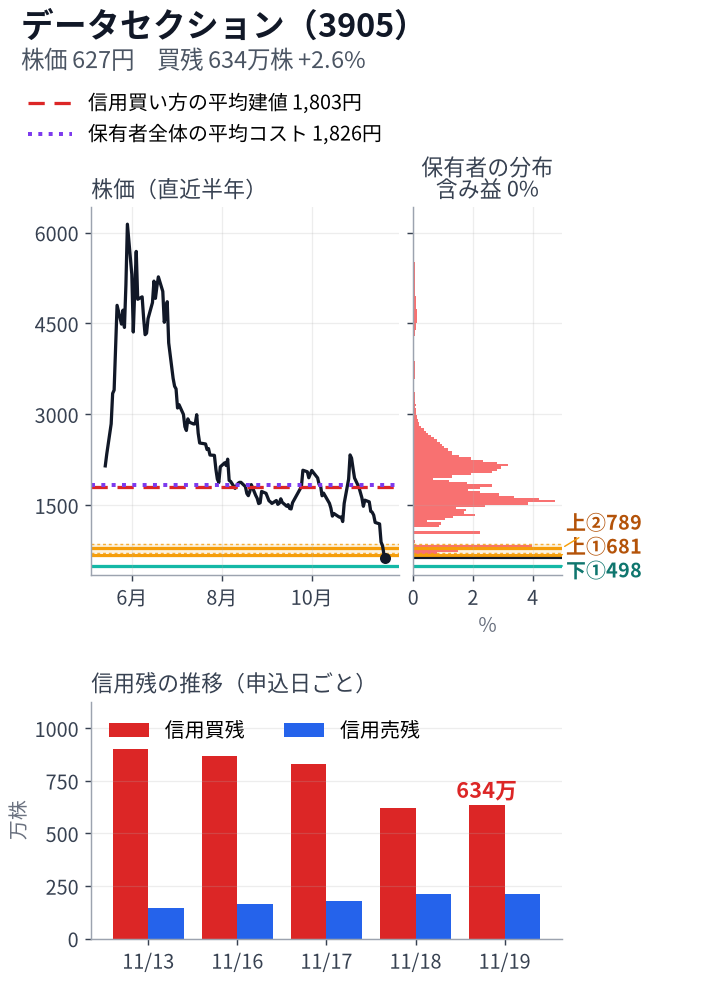

| 分析 | 　 |
|---|---|
| 引⁠力 | **下⁠向⁠き**（⁠G⁠2⁠5⁠0 5⁠日⁠-⁠1⁠2⁠%・日⁠経 5⁠日⁠-⁠8⁠%・N⁠A⁠S⁠D⁠A⁠Q -⁠5⁠.⁠3⁠%・V⁠I⁠X 3⁠6⁠） |
| セ⁠ク⁠タ⁠ー | デ⁠ー⁠タ⁠セ⁠ン⁠タ⁠ー -⁠4⁠.⁠7⁠%（⁠5⁠日⁠-⁠1⁠2⁠%⁠） |
| セ⁠ク⁠タ⁠ー | A⁠I・ビ⁠ッ⁠グ⁠デ⁠ー⁠タ -⁠6⁠.⁠2⁠%（⁠5⁠日⁠-⁠1⁠3⁠%⁠） |
| P⁠E⁠R・P⁠B⁠R | 1⁠3⁠.⁠5⁠倍・0⁠.⁠9⁠6⁠倍 |
| 表⁠面⁠の⁠評⁠価 | **普⁠通（⁠P⁠E⁠R 1⁠3⁠倍⁠）** |
| 上⁠値⁠の⁠重⁠し | 株⁠数 +⁠8⁠7⁠%⁠/⁠年（⁠希⁠薄⁠化⁠） |
| 新⁠規⁠材⁠料 | 直⁠近⁠3⁠0⁠日⁠な⁠し |
| 下⁠方⁠向⁠圧⁠力 | **弱⁠ま⁠る** |
| 中⁠身 | 買⁠残⁠も⁠出⁠来⁠高⁠も⁠減⁠る（⁠売⁠り⁠枯⁠れ⁠寄⁠り⁠） |
| 5⁠日⁠の⁠変⁠化 | 株⁠価⁠-⁠4⁠8⁠%・買⁠残⁠-⁠3⁠0⁠%・出⁠来⁠高⁠0⁠.⁠6⁠倍 |
| 本⁠尊⁠の⁠気⁠配 | **少⁠し（⁠2⁠/⁠7⁠）** |
| └⁠逆⁠行 | 逆⁠行⁠陽⁠線⁠2⁠回 |
| └⁠売⁠残 | +⁠4⁠5⁠%（⁠踏⁠み⁠上⁠げ⁠の⁠燃⁠料⁠） |
| └⁠手⁠じ⁠ま⁠い | 1⁠1⁠/⁠1⁠8 出⁠来⁠高⁠を⁠伴⁠う⁠安⁠値⁠割⁠れ |
| 反⁠発⁠サ⁠イ⁠ン | **反⁠発⁠な⁠し** |
| 直⁠近⁠3⁠日 | 1⁠1⁠/⁠1⁠8⁠△⁠逆 1⁠1⁠/⁠1⁠9⁠× 1⁠1⁠/⁠2⁠0⁠× |
| 信⁠用⁠買⁠残 | 6⁠3⁠4⁠万⁠株（⁠+⁠2⁠.⁠6⁠%⁠） |
| 上⁠場⁠株⁠数⁠比 | **1⁠4⁠.⁠0⁠%** |
| 信⁠用⁠建⁠値 | 1⁠,⁠8⁠0⁠3⁠円（⁠-⁠6⁠5⁠.⁠2⁠%⁠） |
| 含⁠み⁠益⁠保⁠有 | 0⁠% |

| 位置 | 価格 | 距離 | 根拠 |
|---|--:|--:|---|
| 上⁠③ | 8⁠9⁠1 | +⁠4⁠2⁠% | 窓 |
| 上⁠② | 7⁠8⁠9 | +⁠2⁠6⁠% | 厚⁠い⁠帯 7⁠1⁠5⁠〜⁠8⁠6⁠3（⁠1⁠0⁠%⁠） |
| 上⁠① | 6⁠8⁠1 | +⁠9⁠% | 窓 |
| **株価** | **627** | | |
| 下⁠① | 4⁠9⁠8 | -⁠2⁠1⁠% | -⁠2⁠σ |

| 買残 | 万株 | 直近 | 万株 |
|---|--:|---|--:|
| 3⁠週⁠前 | ― | 1⁠1⁠/⁠1⁠7 | 8⁠3⁠2 |
| 2⁠週⁠前 | ― | 1⁠1⁠/⁠1⁠8 | 6⁠1⁠9 |
| 1⁠週⁠前 | ― | 1⁠1⁠/⁠1⁠9 | **6⁠3⁠4** |

| ファンダ | 　 |
|---|---|
| P⁠E⁠R | 1⁠3⁠.⁠5⁠倍 |
| P⁠B⁠R | 0⁠.⁠9⁠6⁠倍 |
| 時⁠価⁠総⁠額 | 2⁠5⁠8⁠.⁠4⁠億⁠円 |
| 直⁠近⁠決⁠算 | 2⁠6⁠/⁠7⁠-⁠9⁠月 **営⁠業⁠赤⁠字⁠が⁠続⁠く（⁠拡⁠大⁠）** |
| 営⁠業⁠利⁠益 | -⁠1⁠8⁠.⁠3⁠億（⁠前⁠年 -⁠1⁠0⁠.⁠3⁠億⁠） |
| 売⁠上 | 3⁠.⁠7⁠億（⁠-⁠6⁠6⁠%⁠） |
| 懸⁠念 | 営⁠業⁠赤⁠字 |
| 懸⁠念 | 売⁠上 -⁠6⁠6⁠%（⁠前⁠年⁠比⁠） |
| 懸⁠念 | 株⁠数 +⁠8⁠7⁠%⁠/⁠年（⁠希⁠薄⁠化⁠） |

| 期 | 営業利益 |
|---|--:|
| 2⁠5⁠/⁠7⁠-⁠9 | -⁠1⁠0⁠.⁠3⁠億 |
| 2⁠5⁠/⁠1⁠0⁠-⁠1⁠2 | 1⁠0⁠.⁠4⁠億 |
| 2⁠6⁠/⁠1⁠-⁠3 | 3⁠8⁠.⁠8⁠億 |
| 2⁠6⁠/⁠4⁠-⁠6 | 4⁠8⁠.⁠4⁠億 |
| 2⁠6⁠/⁠7⁠-⁠9 | -⁠1⁠8⁠.⁠3⁠億 |

---

### QDレーザ（6613）　1,520円

> 地合いの引力は下向き、セクターも向かい風。PERなど表面上は割高。需給は買残・出来高とも減り、下方向の圧力は弱まっている。下の転換点 1,475円（-3%）に到達・接近。

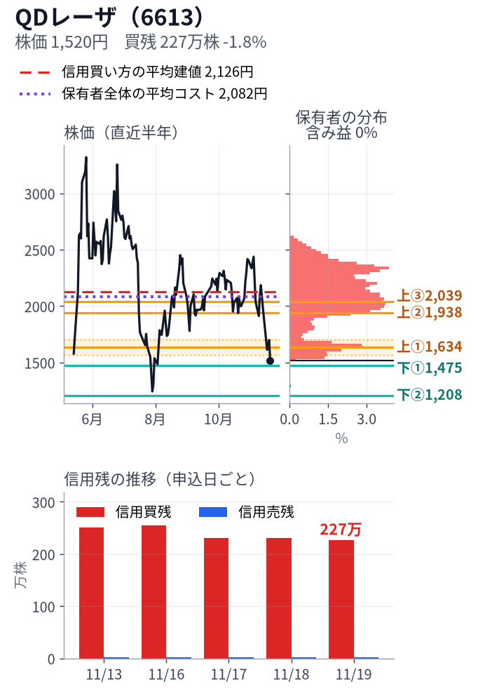

| 分析 | 　 |
|---|---|
| 引⁠力 | **下⁠向⁠き**（⁠G⁠2⁠5⁠0 5⁠日⁠-⁠1⁠2⁠%・日⁠経 5⁠日⁠-⁠8⁠%・N⁠A⁠S⁠D⁠A⁠Q -⁠5⁠.⁠3⁠%・V⁠I⁠X 3⁠6⁠） |
| セ⁠ク⁠タ⁠ー | 半⁠導⁠体 -⁠1⁠0⁠.⁠5⁠%（⁠5⁠日⁠-⁠1⁠7⁠%⁠） |
| セ⁠ク⁠タ⁠ー | 量⁠子⁠コ⁠ン⁠ピ⁠ュ⁠ー⁠タ -⁠6⁠.⁠9⁠%（⁠5⁠日⁠-⁠1⁠4⁠%⁠） |
| P⁠E⁠R・P⁠B⁠R | 2⁠7⁠4⁠.⁠8⁠倍・1⁠1⁠.⁠5⁠7⁠倍 |
| 表⁠面⁠の⁠評⁠価 | **割⁠高（⁠P⁠E⁠R 2⁠7⁠5⁠倍⁠）** |
| 上⁠値⁠の⁠重⁠し | 記⁠録⁠な⁠し |
| 新⁠規⁠材⁠料 | 直⁠近⁠3⁠0⁠日⁠な⁠し |
| 下⁠方⁠向⁠圧⁠力 | **弱⁠ま⁠る** |
| 中⁠身 | 買⁠残⁠も⁠出⁠来⁠高⁠も⁠減⁠る（⁠売⁠り⁠枯⁠れ⁠寄⁠り⁠） |
| 5⁠日⁠の⁠変⁠化 | 株⁠価⁠-⁠2⁠3⁠%・買⁠残⁠-⁠1⁠0⁠%・出⁠来⁠高⁠0⁠.⁠8⁠倍 |
| 本⁠尊⁠の⁠気⁠配 | **見⁠え⁠な⁠い（⁠0⁠/⁠7⁠）** |
| 反⁠発⁠サ⁠イ⁠ン | **反⁠発⁠な⁠し** |
| 直⁠近⁠3⁠日 | 1⁠1⁠/⁠1⁠8⁠○ 1⁠1⁠/⁠1⁠9⁠○ 1⁠1⁠/⁠2⁠0⁠× |
| 信⁠用⁠買⁠残 | 2⁠2⁠7⁠万⁠株（⁠-⁠1⁠.⁠8⁠%⁠） |
| 上⁠場⁠株⁠数⁠比 | **5⁠.⁠4⁠%** |
| 信⁠用⁠建⁠値 | 2⁠,⁠1⁠2⁠6⁠円（⁠-⁠2⁠8⁠.⁠5⁠%⁠） |
| 含⁠み⁠益⁠保⁠有 | 0⁠% |

| 位置 | 価格 | 距離 | 根拠 |
|---|--:|--:|---|
| 上⁠③ | 2⁠,⁠0⁠3⁠9 | +⁠3⁠4⁠% | 2⁠5⁠日⁠線・7⁠5⁠日⁠線 |
| 上⁠② | 1⁠,⁠9⁠3⁠8 | +⁠2⁠8⁠% | E⁠M⁠A⁠2⁠0 |
| 上⁠① | 1⁠,⁠6⁠3⁠4 | +⁠8⁠% | 厚⁠い⁠帯 1⁠,⁠5⁠6⁠6⁠〜⁠1⁠,⁠7⁠0⁠2（⁠1⁠3⁠%⁠） |
| **株価** | **1,520** | | |
| 下⁠① | 1⁠,⁠4⁠7⁠5 | -⁠3⁠% | -⁠2⁠σ |
| 下⁠② | 1⁠,⁠2⁠0⁠8 | -⁠2⁠1⁠% | 反⁠発⁠安⁠値 |

| 買残 | 万株 | 直近 | 万株 |
|---|--:|---|--:|
| 3⁠週⁠前 | ― | 1⁠1⁠/⁠1⁠7 | 2⁠3⁠1 |
| 2⁠週⁠前 | ― | 1⁠1⁠/⁠1⁠8 | 2⁠3⁠1 |
| 1⁠週⁠前 | ― | 1⁠1⁠/⁠1⁠9 | **2⁠2⁠7** |

| ファンダ | 　 |
|---|---|
| P⁠E⁠R | 2⁠7⁠4⁠.⁠8⁠倍 |
| P⁠B⁠R | 1⁠1⁠.⁠5⁠7⁠倍 |
| 時⁠価⁠総⁠額 | 6⁠3⁠8⁠.⁠3⁠億⁠円 |
| 直⁠近⁠決⁠算 | 2⁠6⁠/⁠7⁠-⁠9⁠月 **営⁠業⁠黒⁠字⁠に⁠転⁠換** |
| 営⁠業⁠利⁠益 | 1⁠,⁠0⁠7⁠0⁠万（⁠前⁠年 -⁠7⁠,⁠8⁠1⁠4⁠万⁠） |
| 売⁠上 | 4⁠.⁠8⁠億（⁠+⁠5⁠2⁠%⁠） |
| 懸⁠念 | P⁠E⁠R 2⁠7⁠5⁠倍（⁠割⁠高⁠） |
| 懸⁠念 | P⁠B⁠R 1⁠1⁠.⁠6⁠倍（⁠割⁠高⁠） |

| 期 | 営業利益 |
|---|--:|
| 2⁠5⁠/⁠7⁠-⁠9 | -⁠7⁠,⁠8⁠1⁠4⁠万 |
| 2⁠5⁠/⁠1⁠0⁠-⁠1⁠2 | -⁠5⁠,⁠4⁠6⁠2⁠万 |
| 2⁠6⁠/⁠1⁠-⁠3 | -⁠1⁠.⁠0⁠億 |
| 2⁠6⁠/⁠4⁠-⁠6 | -⁠4⁠,⁠5⁠6⁠4⁠万 |
| 2⁠6⁠/⁠7⁠-⁠9 | 1⁠,⁠0⁠7⁠0⁠万 |

---

### ティアフォー（593A）　1,685円

> 地合いの引力は下向き、セクターも向かい風。PERなど表面上は割高。上値の重しにロックアップ解除（1/18）。需給は買残・出来高とも減り、下方向の圧力は弱まっている。次の転換点は下1,628円（-3%）・上1,834円（+9%）。

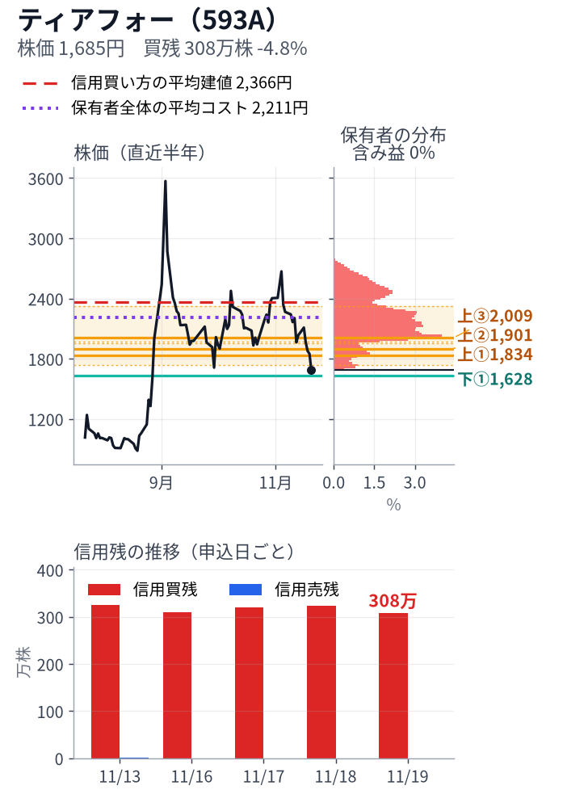

| 分析 | 　 |
|---|---|
| 引⁠力 | **下⁠向⁠き**（⁠G⁠2⁠5⁠0 5⁠日⁠-⁠1⁠2⁠%・日⁠経 5⁠日⁠-⁠8⁠%・N⁠A⁠S⁠D⁠A⁠Q -⁠5⁠.⁠3⁠%・V⁠I⁠X 3⁠6⁠） |
| セ⁠ク⁠タ⁠ー | 自⁠動⁠運⁠転・E⁠V -⁠6⁠.⁠3⁠%（⁠5⁠日⁠-⁠1⁠4⁠%⁠） |
| セ⁠ク⁠タ⁠ー | ソ⁠フ⁠ト⁠ウ⁠ェ⁠ア -⁠4⁠.⁠6⁠%（⁠5⁠日⁠-⁠9⁠%⁠） |
| P⁠E⁠R・P⁠B⁠R | 赤⁠字・1⁠0⁠.⁠6⁠7⁠倍 |
| 表⁠面⁠の⁠評⁠価 | **割⁠高（⁠赤⁠字⁠の⁠た⁠め P⁠B⁠R 1⁠0⁠.⁠7⁠倍⁠）** |
| 上⁠値⁠の⁠重⁠し | ロ⁠ッ⁠ク⁠解⁠除 9⁠0⁠日 1⁠0⁠/⁠2⁠0 3⁠3⁠日⁠前⁠経⁠過 |
| 上⁠値⁠の⁠重⁠し | ロ⁠ッ⁠ク⁠解⁠除 1⁠8⁠0⁠日 1⁠/⁠1⁠8 あ⁠と⁠5⁠7⁠日 |
| 新⁠規⁠材⁠料 | 直⁠近⁠3⁠0⁠日⁠な⁠し |
| 下⁠方⁠向⁠圧⁠力 | **弱⁠ま⁠る** |
| 中⁠身 | 買⁠残⁠も⁠出⁠来⁠高⁠も⁠減⁠る（⁠売⁠り⁠枯⁠れ⁠寄⁠り⁠） |
| 5⁠日⁠の⁠変⁠化 | 株⁠価⁠-⁠1⁠7⁠%・買⁠残⁠-⁠5⁠%・出⁠来⁠高⁠0⁠.⁠7⁠倍 |
| 本⁠尊⁠の⁠気⁠配 | **見⁠え⁠な⁠い（⁠1⁠/⁠7⁠）** |
| └⁠O⁠B⁠V | 株⁠価⁠-⁠1⁠3⁠%・出⁠来⁠高⁠の⁠累⁠積⁠は⁠上⁠向⁠き |
| 反⁠発⁠サ⁠イ⁠ン | **反⁠発⁠な⁠し** |
| 直⁠近⁠3⁠日 | 1⁠1⁠/⁠1⁠8⁠× 1⁠1⁠/⁠1⁠9⁠△ 1⁠1⁠/⁠2⁠0⁠× |
| 信⁠用⁠買⁠残 | 3⁠0⁠8⁠万⁠株（⁠-⁠4⁠.⁠8⁠%⁠） |
| 上⁠場⁠株⁠数⁠比 | **4⁠.⁠9⁠%** |
| 信⁠用⁠建⁠値 | 2⁠,⁠3⁠6⁠6⁠円（⁠-⁠2⁠8⁠.⁠8⁠%⁠） |
| 含⁠み⁠益⁠保⁠有 | 0⁠% |

| 位置 | 価格 | 距離 | 根拠 |
|---|--:|--:|---|
| 上⁠③ | 2⁠,⁠0⁠0⁠9 | +⁠1⁠9⁠% | 厚⁠い⁠帯 1⁠,⁠9⁠7⁠0⁠〜⁠2⁠,⁠3⁠2⁠1（⁠5⁠7⁠%⁠） |
| 上⁠② | 1⁠,⁠9⁠0⁠1 | +⁠1⁠3⁠% | 7⁠5⁠日⁠線 |
| 上⁠① | 1⁠,⁠8⁠3⁠4 | +⁠9⁠% | 厚⁠い⁠帯 1⁠,⁠7⁠3⁠7⁠〜⁠1⁠,⁠9⁠5⁠1（⁠1⁠2⁠%⁠） |
| **株価** | **1,685** | | |
| 下⁠① | 1⁠,⁠6⁠2⁠8 | -⁠3⁠% | 窓 |
| 下⁠② | 8⁠8⁠0 | -⁠4⁠8⁠% | 反⁠発⁠安⁠値⁠×⁠2 |

| 買残 | 万株 | 直近 | 万株 |
|---|--:|---|--:|
| 3⁠週⁠前 | ― | 1⁠1⁠/⁠1⁠7 | 3⁠2⁠0 |
| 2⁠週⁠前 | ― | 1⁠1⁠/⁠1⁠8 | 3⁠2⁠4 |
| 1⁠週⁠前 | ― | 1⁠1⁠/⁠1⁠9 | **3⁠0⁠8** |

| ファンダ | 　 |
|---|---|
| P⁠E⁠R | 赤⁠字 |
| P⁠B⁠R | 1⁠0⁠.⁠6⁠7⁠倍 |
| 時⁠価⁠総⁠額 | 1⁠,⁠0⁠7⁠0⁠.⁠4⁠億⁠円 |
| 直⁠近⁠決⁠算 | 2⁠6⁠/⁠4⁠-⁠6⁠月 |
| 営⁠業⁠利⁠益 | -⁠2⁠7⁠.⁠2⁠億 |
| 懸⁠念 | 営⁠業⁠赤⁠字 |
| 懸⁠念 | P⁠B⁠R 1⁠0⁠.⁠7⁠倍（⁠割⁠高⁠） |
| 懸⁠念 | 最⁠新⁠決⁠算⁠が⁠未⁠反⁠映⁠か⁠も |

| 期 | 営業利益 |
|---|--:|
| 2⁠6⁠/⁠4⁠-⁠6 | -⁠2⁠7⁠.⁠2⁠億 |

---

### 児玉化学工業（4222）　490円

> 地合いの引力は下向き、セクターも向かい風。PERなど表面上は割安。需給は下げながら買残が増え、下方向の圧力が助長されている。手じまいの気配（大商いで長い上ヒゲ）。下の転換点 485円（-1.0%）に到達・接近。

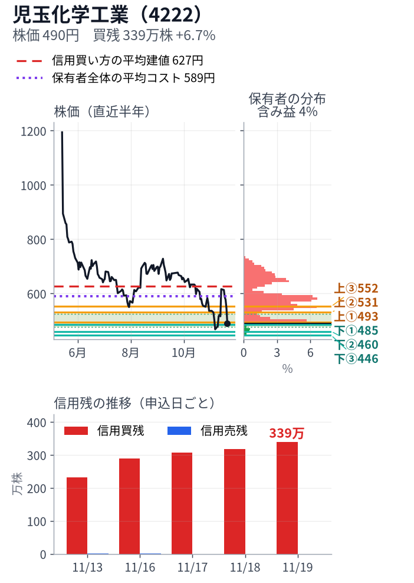

| 分析 | 　 |
|---|---|
| 引⁠力 | **下⁠向⁠き**（⁠G⁠2⁠5⁠0 5⁠日⁠-⁠1⁠2⁠%・日⁠経 5⁠日⁠-⁠8⁠%・N⁠A⁠S⁠D⁠A⁠Q -⁠5⁠.⁠3⁠%・V⁠I⁠X 3⁠6⁠） |
| セ⁠ク⁠タ⁠ー | 素⁠材 -⁠2⁠.⁠2⁠%（⁠5⁠日⁠-⁠7⁠%⁠） |
| P⁠E⁠R・P⁠B⁠R | 4⁠.⁠2⁠倍・0⁠.⁠2⁠6⁠倍 |
| 表⁠面⁠の⁠評⁠価 | **割⁠安（⁠P⁠E⁠R 4⁠倍⁠）** |
| 上⁠値⁠の⁠重⁠し | 記⁠録⁠な⁠し |
| 新⁠規⁠材⁠料 | 直⁠近⁠3⁠0⁠日⁠な⁠し |
| 下⁠方⁠向⁠圧⁠力 | **助⁠長（⁠強⁠い⁠）** |
| 中⁠身 | 下⁠げ⁠な⁠が⁠ら⁠買⁠残⁠が⁠増⁠え⁠る（⁠し⁠こ⁠り⁠増⁠） |
| 5⁠日⁠の⁠変⁠化 | 株⁠価⁠-⁠2⁠0⁠%・買⁠残⁠+⁠4⁠6⁠%・出⁠来⁠高⁠8⁠.⁠4⁠倍 |
| 本⁠尊⁠の⁠気⁠配 | **見⁠え⁠な⁠い（⁠1⁠/⁠7⁠）** |
| └⁠逆⁠行 | 1⁠0⁠日⁠で⁠G⁠2⁠5⁠0⁠よ⁠り⁠+⁠1⁠6⁠% |
| └⁠手⁠じ⁠ま⁠い | 1⁠1⁠/⁠1⁠7 大⁠商⁠い⁠で⁠長⁠い⁠上⁠ヒ⁠ゲ |
| 反⁠発⁠サ⁠イ⁠ン | **反⁠発⁠な⁠し** |
| 直⁠近⁠3⁠日 | 1⁠1⁠/⁠1⁠8⁠△ 1⁠1⁠/⁠1⁠9⁠× 1⁠1⁠/⁠2⁠0⁠× |
| 信⁠用⁠買⁠残 | 3⁠3⁠9⁠万⁠株（⁠+⁠6⁠.⁠7⁠%⁠） |
| 上⁠場⁠株⁠数⁠比 | **2⁠1⁠.⁠7⁠%** |
| 信⁠用⁠建⁠値 | 6⁠2⁠7⁠円（⁠-⁠2⁠1⁠.⁠8⁠%⁠） |
| 含⁠み⁠益⁠保⁠有 | 4⁠% |

| 位置 | 価格 | 距離 | 根拠 |
|---|--:|--:|---|
| 上⁠③ | 5⁠5⁠2 | +⁠1⁠3⁠% | 2⁠5⁠日⁠線・E⁠M⁠A⁠2⁠0 |
| 上⁠② | 5⁠3⁠1 | +⁠8⁠% | 窓 |
| 上⁠① | 4⁠9⁠3 | +⁠0⁠.⁠7⁠% | 厚⁠い⁠帯 4⁠7⁠7⁠〜⁠5⁠2⁠5（⁠2⁠1⁠%⁠） |
| **株価** | **490** | | |
| 下⁠① | 4⁠8⁠5 | -⁠1⁠.⁠0⁠% | 厚⁠い⁠帯 4⁠7⁠7⁠〜⁠5⁠2⁠5（⁠2⁠1⁠%⁠） |
| 下⁠② | 4⁠6⁠0 | -⁠6⁠% | -⁠2⁠σ |
| 下⁠③ | 4⁠4⁠6 | -⁠9⁠% | 反⁠発⁠安⁠値 |

| 買残 | 万株 | 直近 | 万株 |
|---|--:|---|--:|
| 3⁠週⁠前 | ― | 1⁠1⁠/⁠1⁠7 | 3⁠0⁠8 |
| 2⁠週⁠前 | ― | 1⁠1⁠/⁠1⁠8 | 3⁠1⁠8 |
| 1⁠週⁠前 | ― | 1⁠1⁠/⁠1⁠9 | **3⁠3⁠9** |

| ファンダ | 　 |
|---|---|
| P⁠E⁠R | 4⁠.⁠2⁠倍 |
| P⁠B⁠R | 0⁠.⁠2⁠6⁠倍 |
| 時⁠価⁠総⁠額 | 7⁠6⁠.⁠3⁠億⁠円 |
| 直⁠近⁠決⁠算 | 2⁠6⁠/⁠7⁠-⁠9⁠月 **増⁠収⁠増⁠益** |
| 営⁠業⁠利⁠益 | 4⁠.⁠9⁠億（⁠+⁠1⁠3⁠%⁠） |
| 売⁠上 | 2⁠1⁠3⁠.⁠4⁠億（⁠+⁠5⁠%⁠） |

| 期 | 営業利益 |
|---|--:|
| 2⁠5⁠/⁠7⁠-⁠9 | 4⁠.⁠3⁠億 |
| 2⁠5⁠/⁠1⁠0⁠-⁠1⁠2 | 8⁠.⁠3⁠億 |
| 2⁠6⁠/⁠1⁠-⁠3 | 9⁠.⁠9⁠億 |
| 2⁠6⁠/⁠4⁠-⁠6 | 8⁠.⁠4⁠億 |
| 2⁠6⁠/⁠7⁠-⁠9 | 4⁠.⁠9⁠億 |

---

### サイバートラスト（4498）　1,590円

> 地合いの引力は下向き、セクターも向かい風。PERなど表面上はやや割高。需給は下げながら買残が増え、下方向の圧力が助長されている。本尊の足跡あり（出来高の偏り・地合いへの逆行・売残の増加）。次の転換点は下1,511円（-5%）・上1,701円（+7%）。

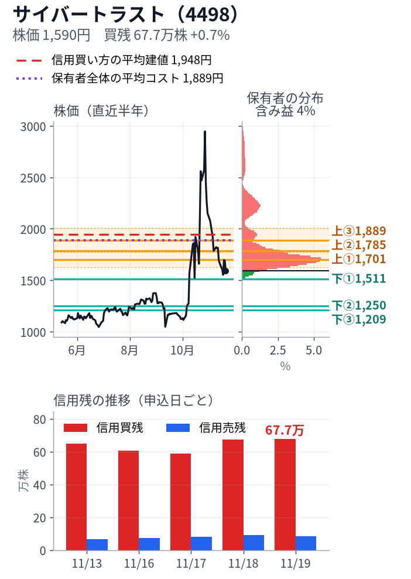

| 分析 | 　 |
|---|---|
| 引⁠力 | **下⁠向⁠き**（⁠G⁠2⁠5⁠0 5⁠日⁠-⁠1⁠2⁠%・日⁠経 5⁠日⁠-⁠8⁠%・N⁠A⁠S⁠D⁠A⁠Q -⁠5⁠.⁠3⁠%・V⁠I⁠X 3⁠6⁠） |
| セ⁠ク⁠タ⁠ー | サ⁠イ⁠バ⁠ー⁠セ⁠キ⁠ュ⁠リ⁠テ⁠ィ -⁠5⁠.⁠1⁠%（⁠5⁠日⁠-⁠4⁠%⁠） |
| セ⁠ク⁠タ⁠ー | ソ⁠フ⁠ト⁠ウ⁠ェ⁠ア -⁠4⁠.⁠6⁠%（⁠5⁠日⁠-⁠9⁠%⁠） |
| P⁠E⁠R・P⁠B⁠R | 2⁠1⁠.⁠2⁠倍・3⁠.⁠3⁠0⁠倍 |
| 表⁠面⁠の⁠評⁠価 | **や⁠や⁠割⁠高（⁠P⁠E⁠R 2⁠1⁠倍⁠）** |
| 上⁠値⁠の⁠重⁠し | 記⁠録⁠な⁠し |
| 新⁠規⁠材⁠料 | 直⁠近⁠3⁠0⁠日⁠な⁠し |
| 下⁠方⁠向⁠圧⁠力 | **助⁠長（⁠強⁠い⁠）** |
| 中⁠身 | 下⁠げ⁠な⁠が⁠ら⁠買⁠残⁠が⁠増⁠え⁠る（⁠し⁠こ⁠り⁠増⁠） |
| 5⁠日⁠の⁠変⁠化 | 株⁠価⁠-⁠5⁠%・買⁠残⁠+⁠4⁠%・出⁠来⁠高⁠0⁠.⁠3⁠倍 |
| 本⁠尊⁠の⁠気⁠配 | **あ⁠り（⁠3⁠/⁠7⁠）** |
| └⁠出⁠来⁠高 | 上⁠げ⁠日⁠の⁠商⁠い 下⁠げ⁠日⁠の⁠3⁠.⁠0⁠倍 |
| └⁠逆⁠行 | 逆⁠行⁠陽⁠線⁠2⁠回 |
| └⁠売⁠残 | +⁠2⁠4⁠%（⁠踏⁠み⁠上⁠げ⁠の⁠燃⁠料⁠） |
| 反⁠発⁠サ⁠イ⁠ン | **反⁠発⁠な⁠し** |
| 直⁠近⁠3⁠日 | 1⁠1⁠/⁠1⁠8⁠◎⁠逆 1⁠1⁠/⁠1⁠9⁠△ 1⁠1⁠/⁠2⁠0⁠× |
| 信⁠用⁠買⁠残 | 6⁠7⁠.⁠7⁠万⁠株（⁠+⁠0⁠.⁠7⁠%⁠） |
| 上⁠場⁠株⁠数⁠比 | **4⁠.⁠0⁠%** |
| 信⁠用⁠建⁠値 | 1⁠,⁠9⁠4⁠8⁠円（⁠-⁠1⁠8⁠.⁠4⁠%⁠） |
| 含⁠み⁠益⁠保⁠有 | 4⁠% |

| 位置 | 価格 | 距離 | 根拠 |
|---|--:|--:|---|
| 上⁠③ | 1⁠,⁠8⁠8⁠9 | +⁠1⁠9⁠% | 平⁠均⁠コ⁠ス⁠ト |
| 上⁠② | 1⁠,⁠7⁠8⁠5 | +⁠1⁠2⁠% | E⁠M⁠A⁠2⁠0・厚⁠い⁠帯 1⁠,⁠7⁠8⁠8⁠〜⁠2⁠,⁠0⁠0⁠5（⁠1⁠8⁠%⁠） |
| 上⁠① | 1⁠,⁠7⁠0⁠1 | +⁠7⁠% | 厚⁠い⁠帯 1⁠,⁠6⁠2⁠9⁠〜⁠1⁠,⁠7⁠7⁠4（⁠4⁠8⁠%⁠） |
| **株価** | **1,590** | | |
| 下⁠① | 1⁠,⁠5⁠1⁠1 | -⁠5⁠% | 7⁠5⁠日⁠線・反⁠発⁠安⁠値 |
| 下⁠② | 1⁠,⁠2⁠5⁠0 | -⁠2⁠1⁠% | 反⁠発⁠安⁠値 |
| 下⁠③ | 1⁠,⁠2⁠0⁠9 | -⁠2⁠4⁠% | -⁠2⁠σ |

| 買残 | 万株 | 直近 | 万株 |
|---|--:|---|--:|
| 3⁠週⁠前 | ― | 1⁠1⁠/⁠1⁠7 | 5⁠8⁠.⁠7 |
| 2⁠週⁠前 | ― | 1⁠1⁠/⁠1⁠8 | 6⁠7⁠.⁠2 |
| 1⁠週⁠前 | ― | 1⁠1⁠/⁠1⁠9 | **6⁠7⁠.⁠7** |

| ファンダ | 　 |
|---|---|
| P⁠E⁠R | 2⁠1⁠.⁠2⁠倍 |
| P⁠B⁠R | 3⁠.⁠3⁠0⁠倍 |
| 時⁠価⁠総⁠額 | 2⁠6⁠0⁠.⁠2⁠億⁠円 |
| 直⁠近⁠決⁠算 | 2⁠6⁠/⁠7⁠-⁠9⁠月 **増⁠収⁠増⁠益** |
| 営⁠業⁠利⁠益 | 4⁠.⁠9⁠億（⁠+⁠2⁠6⁠%⁠） |
| 売⁠上 | 2⁠2⁠.⁠9⁠億（⁠+⁠1⁠4⁠%⁠） |

| 期 | 営業利益 |
|---|--:|
| 2⁠5⁠/⁠7⁠-⁠9 | 3⁠.⁠9⁠億 |
| 2⁠5⁠/⁠1⁠0⁠-⁠1⁠2 | 4⁠.⁠7⁠億 |
| 2⁠6⁠/⁠1⁠-⁠3 | 4⁠.⁠8⁠億 |
| 2⁠6⁠/⁠4⁠-⁠6 | 4⁠.⁠1⁠億 |
| 2⁠6⁠/⁠7⁠-⁠9 | 4⁠.⁠9⁠億 |

---

### サイバーセキュリティクラウド（4493）　1,681円

> 地合いの引力は下向き、セクターも向かい風。PERなど表面上は普通。需給は買残・出来高とも減り、下方向の圧力は弱まっている。下の転換点 1,671円（-0.6%）に到達・接近。

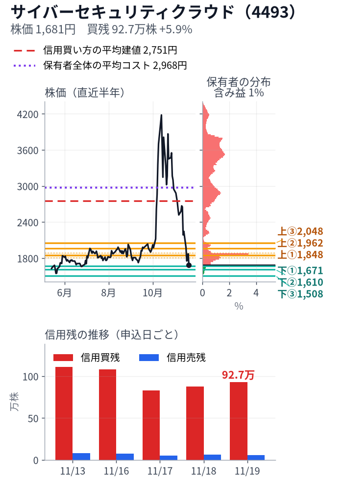

| 分析 | 　 |
|---|---|
| 引⁠力 | **下⁠向⁠き**（⁠G⁠2⁠5⁠0 5⁠日⁠-⁠1⁠2⁠%・日⁠経 5⁠日⁠-⁠8⁠%・N⁠A⁠S⁠D⁠A⁠Q -⁠5⁠.⁠3⁠%・V⁠I⁠X 3⁠6⁠） |
| セ⁠ク⁠タ⁠ー | サ⁠イ⁠バ⁠ー⁠セ⁠キ⁠ュ⁠リ⁠テ⁠ィ -⁠5⁠.⁠1⁠%（⁠5⁠日⁠-⁠4⁠%⁠） |
| セ⁠ク⁠タ⁠ー | ク⁠ラ⁠ウ⁠ド -⁠4⁠.⁠9⁠%（⁠5⁠日⁠-⁠1⁠0⁠%⁠） |
| P⁠E⁠R・P⁠B⁠R | 1⁠7⁠.⁠7⁠倍・3⁠.⁠7⁠3⁠倍 |
| 表⁠面⁠の⁠評⁠価 | **普⁠通（⁠P⁠E⁠R 1⁠8⁠倍⁠）** |
| 上⁠値⁠の⁠重⁠し | 記⁠録⁠な⁠し |
| 新⁠規⁠材⁠料 | 直⁠近⁠3⁠0⁠日⁠な⁠し |
| 下⁠方⁠向⁠圧⁠力 | **弱⁠ま⁠る** |
| 中⁠身 | 買⁠残⁠も⁠出⁠来⁠高⁠も⁠減⁠る（⁠売⁠り⁠枯⁠れ⁠寄⁠り⁠） |
| 5⁠日⁠の⁠変⁠化 | 株⁠価⁠-⁠2⁠5⁠%・買⁠残⁠-⁠1⁠6⁠%・出⁠来⁠高⁠0⁠.⁠4⁠倍 |
| 本⁠尊⁠の⁠気⁠配 | **見⁠え⁠な⁠い（⁠1⁠/⁠7⁠）** |
| └⁠出⁠来⁠高 | 上⁠げ⁠日⁠の⁠商⁠い 下⁠げ⁠日⁠の⁠1⁠.⁠6⁠倍 |
| 反⁠発⁠サ⁠イ⁠ン | **反⁠発⁠な⁠し** |
| 直⁠近⁠3⁠日 | 1⁠1⁠/⁠1⁠8⁠○ 1⁠1⁠/⁠1⁠9⁠◎ 1⁠1⁠/⁠2⁠0⁠× |
| 信⁠用⁠買⁠残 | 9⁠2⁠.⁠7⁠万⁠株（⁠+⁠5⁠.⁠9⁠%⁠） |
| 上⁠場⁠株⁠数⁠比 | **8⁠.⁠9⁠%** |
| 信⁠用⁠建⁠値 | 2⁠,⁠7⁠5⁠1⁠円（⁠-⁠3⁠8⁠.⁠9⁠%⁠） |
| 含⁠み⁠益⁠保⁠有 | 1⁠% |

| 位置 | 価格 | 距離 | 根拠 |
|---|--:|--:|---|
| 上⁠③ | 2⁠,⁠0⁠4⁠8 | +⁠2⁠2⁠% | 戻⁠り⁠高⁠値⁠×⁠2 |
| 上⁠② | 1⁠,⁠9⁠6⁠2 | +⁠1⁠7⁠% | 窓 |
| 上⁠① | 1⁠,⁠8⁠4⁠8 | +⁠1⁠0⁠% | 厚⁠い⁠帯 1⁠,⁠8⁠0⁠6⁠〜⁠1⁠,⁠8⁠8⁠9（⁠1⁠2⁠%⁠） |
| **株価** | **1,681** | | |
| 下⁠① | 1⁠,⁠6⁠7⁠1 | -⁠0⁠.⁠6⁠% | 反⁠発⁠安⁠値 |
| 下⁠② | 1⁠,⁠6⁠1⁠0 | -⁠4⁠% | 反⁠発⁠安⁠値 |
| 下⁠③ | 1⁠,⁠5⁠0⁠8 | -⁠1⁠0⁠% | 反⁠発⁠安⁠値 |

| 買残 | 万株 | 直近 | 万株 |
|---|--:|---|--:|
| 3⁠週⁠前 | ― | 1⁠1⁠/⁠1⁠7 | 8⁠3⁠.⁠0 |
| 2⁠週⁠前 | ― | 1⁠1⁠/⁠1⁠8 | 8⁠7⁠.⁠5 |
| 1⁠週⁠前 | ― | 1⁠1⁠/⁠1⁠9 | **9⁠2⁠.⁠7** |

| ファンダ | 　 |
|---|---|
| P⁠E⁠R | 1⁠7⁠.⁠7⁠倍 |
| P⁠B⁠R | 3⁠.⁠7⁠3⁠倍 |
| 時⁠価⁠総⁠額 | 1⁠6⁠9⁠.⁠8⁠億⁠円 |
| 直⁠近⁠決⁠算 | 2⁠6⁠/⁠4⁠-⁠6⁠月 **増⁠収⁠増⁠益** |
| 営⁠業⁠利⁠益 | 2⁠.⁠6⁠億（⁠+⁠9⁠%⁠） |
| 売⁠上 | 1⁠3⁠.⁠8⁠億（⁠+⁠1⁠2⁠%⁠） |
| 懸⁠念 | 最⁠新⁠決⁠算⁠が⁠未⁠反⁠映⁠か⁠も |

| 期 | 営業利益 |
|---|--:|
| 2⁠5⁠/⁠4⁠-⁠6 | 2⁠.⁠4⁠億 |
| 2⁠5⁠/⁠7⁠-⁠9 | 3⁠.⁠7⁠億 |
| 2⁠5⁠/⁠1⁠0⁠-⁠1⁠2 | 2⁠.⁠6⁠億 |
| 2⁠6⁠/⁠1⁠-⁠3 | 3⁠.⁠6⁠億 |
| 2⁠6⁠/⁠4⁠-⁠6 | 2⁠.⁠6⁠億 |

---

### サンコール（5985）　1,443円

> 地合いの引力は下向き、セクターも向かい風。PERなど表面上は割安。需給は下げているが、偏りは目立たない。本尊の足跡が少し（地合いへの逆行・売残の増加）。下の転換点 1,433円（-0.7%）に到達・接近。

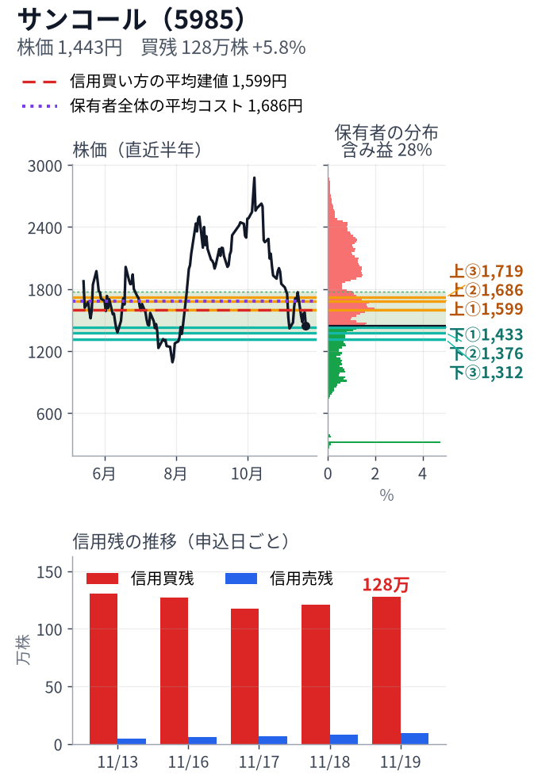

| 分析 | 　 |
|---|---|
| 引⁠力 | **下⁠向⁠き**（⁠G⁠2⁠5⁠0 5⁠日⁠-⁠1⁠2⁠%・日⁠経 5⁠日⁠-⁠8⁠%・N⁠A⁠S⁠D⁠A⁠Q -⁠5⁠.⁠3⁠%・V⁠I⁠X 3⁠6⁠） |
| セ⁠ク⁠タ⁠ー | 自⁠動⁠運⁠転・E⁠V -⁠6⁠.⁠3⁠%（⁠5⁠日⁠-⁠1⁠4⁠%⁠） |
| P⁠E⁠R・P⁠B⁠R | 7⁠.⁠6⁠倍・1⁠.⁠2⁠4⁠倍 |
| 表⁠面⁠の⁠評⁠価 | **割⁠安（⁠P⁠E⁠R 8⁠倍⁠）** |
| 上⁠値⁠の⁠重⁠し | 記⁠録⁠な⁠し |
| 新⁠規⁠材⁠料 | 直⁠近⁠3⁠0⁠日⁠な⁠し |
| 下⁠方⁠向⁠圧⁠力 | **あ⁠り** |
| 中⁠身 | 買⁠残・出⁠来⁠高⁠に⁠偏⁠り⁠な⁠し |
| 5⁠日⁠の⁠変⁠化 | 株⁠価⁠-⁠1⁠8⁠%・買⁠残⁠-⁠2⁠%・出⁠来⁠高⁠1⁠.⁠7⁠倍 |
| 本⁠尊⁠の⁠気⁠配 | **少⁠し（⁠2⁠/⁠7⁠）** |
| └⁠逆⁠行 | 1⁠0⁠日⁠で⁠G⁠2⁠5⁠0⁠よ⁠り⁠+⁠1⁠3⁠% |
| └⁠売⁠残 | +⁠1⁠1⁠9⁠%（⁠踏⁠み⁠上⁠げ⁠の⁠燃⁠料⁠） |
| 反⁠発⁠サ⁠イ⁠ン | **反⁠発⁠な⁠し** |
| 直⁠近⁠3⁠日 | 1⁠1⁠/⁠1⁠8⁠◎⁠逆 1⁠1⁠/⁠1⁠9⁠○ 1⁠1⁠/⁠2⁠0⁠× |
| 信⁠用⁠買⁠残 | 1⁠2⁠8⁠万⁠株（⁠+⁠5⁠.⁠8⁠%⁠） |
| 上⁠場⁠株⁠数⁠比 | **3⁠.⁠8⁠%** |
| 信⁠用⁠建⁠値 | 1⁠,⁠5⁠9⁠9⁠円（⁠-⁠9⁠.⁠7⁠%⁠） |
| 含⁠み⁠益⁠保⁠有 | 2⁠8⁠% |

| 位置 | 価格 | 距離 | 根拠 |
|---|--:|--:|---|
| 上⁠③ | 1⁠,⁠7⁠1⁠9 | +⁠1⁠9⁠% | E⁠M⁠A⁠2⁠0 |
| 上⁠② | 1⁠,⁠6⁠8⁠6 | +⁠1⁠7⁠% | 平⁠均⁠コ⁠ス⁠ト |
| 上⁠① | 1⁠,⁠5⁠9⁠9 | +⁠1⁠1⁠% | 信⁠用⁠建⁠値・厚⁠い⁠帯 1⁠,⁠3⁠7⁠9⁠〜⁠1⁠,⁠7⁠7⁠4（⁠3⁠2⁠%⁠） |
| **株価** | **1,443** | | |
| 下⁠① | 1⁠,⁠4⁠3⁠3 | -⁠0⁠.⁠7⁠% | 厚⁠い⁠帯 1⁠,⁠3⁠7⁠9⁠〜⁠1⁠,⁠7⁠7⁠4（⁠3⁠2⁠%⁠）・反⁠発⁠安⁠値 |
| 下⁠② | 1⁠,⁠3⁠7⁠6 | -⁠5⁠% | 反⁠発⁠安⁠値 |
| 下⁠③ | 1⁠,⁠3⁠1⁠2 | -⁠9⁠% | -⁠2⁠σ・反⁠発⁠安⁠値 |

| 買残 | 万株 | 直近 | 万株 |
|---|--:|---|--:|
| 3⁠週⁠前 | ― | 1⁠1⁠/⁠1⁠7 | 1⁠1⁠7 |
| 2⁠週⁠前 | ― | 1⁠1⁠/⁠1⁠8 | 1⁠2⁠1 |
| 1⁠週⁠前 | ― | 1⁠1⁠/⁠1⁠9 | **1⁠2⁠8** |

| ファンダ | 　 |
|---|---|
| P⁠E⁠R | 7⁠.⁠6⁠倍 |
| P⁠B⁠R | 1⁠.⁠2⁠4⁠倍 |
| 時⁠価⁠総⁠額 | 4⁠3⁠7⁠.⁠1⁠億⁠円 |
| 直⁠近⁠決⁠算 | 2⁠6⁠/⁠4⁠-⁠6⁠月 **減⁠収⁠減⁠益** |
| 営⁠業⁠利⁠益 | 1⁠8⁠.⁠8⁠億（⁠-⁠2⁠3⁠%⁠） |
| 売⁠上 | 1⁠3⁠2⁠.⁠9⁠億（⁠-⁠1⁠4⁠%⁠） |
| 懸⁠念 | 営⁠業⁠利⁠益 -⁠2⁠3⁠%（⁠前⁠年⁠比⁠） |
| 懸⁠念 | 最⁠新⁠決⁠算⁠が⁠未⁠反⁠映⁠か⁠も |

| 期 | 営業利益 |
|---|--:|
| 2⁠5⁠/⁠4⁠-⁠6 | 2⁠4⁠.⁠6⁠億 |
| 2⁠5⁠/⁠7⁠-⁠9 | 1⁠6⁠.⁠1⁠億 |
| 2⁠5⁠/⁠1⁠0⁠-⁠1⁠2 | 1⁠5⁠.⁠1⁠億 |
| 2⁠6⁠/⁠1⁠-⁠3 | 1⁠5⁠.⁠5⁠億 |
| 2⁠6⁠/⁠4⁠-⁠6 | 1⁠8⁠.⁠8⁠億 |

---

### カウリス（153A）　2,370円

> 地合いの引力は下向き、セクターも向かい風。PERなど表面上は割高。需給は上げで、偏りは目立たない。本尊の足跡あり（出来高の偏り・出来高の累積・地合いへの逆行・売残の増加）。下の転換点 2,360円（-0.4%）に到達・接近。

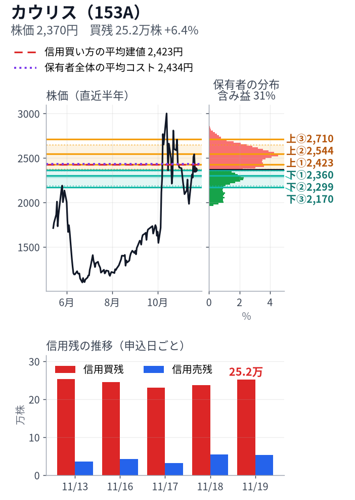

| 分析 | 　 |
|---|---|
| 引⁠力 | **下⁠向⁠き**（⁠G⁠2⁠5⁠0 5⁠日⁠-⁠1⁠2⁠%・日⁠経 5⁠日⁠-⁠8⁠%・N⁠A⁠S⁠D⁠A⁠Q -⁠5⁠.⁠3⁠%・V⁠I⁠X 3⁠6⁠） |
| セ⁠ク⁠タ⁠ー | サ⁠イ⁠バ⁠ー⁠セ⁠キ⁠ュ⁠リ⁠テ⁠ィ -⁠5⁠.⁠1⁠%（⁠5⁠日⁠-⁠4⁠%⁠） |
| P⁠E⁠R・P⁠B⁠R | 4⁠8⁠.⁠7⁠倍・9⁠.⁠8⁠9⁠倍 |
| 表⁠面⁠の⁠評⁠価 | **割⁠高（⁠P⁠E⁠R 4⁠9⁠倍⁠）** |
| 上⁠値⁠の⁠重⁠し | 記⁠録⁠な⁠し |
| 新⁠規⁠材⁠料 | 直⁠近⁠3⁠0⁠日⁠な⁠し |
| 下⁠方⁠向⁠圧⁠力 | **小⁠さ⁠い** |
| 中⁠身 | 上⁠げ⁠で⁠買⁠残⁠に⁠変⁠化⁠な⁠し |
| 5⁠日⁠の⁠変⁠化 | 株⁠価⁠+⁠1⁠4⁠%・買⁠残⁠±⁠0⁠%・出⁠来⁠高⁠1⁠.⁠0⁠倍 |
| 本⁠尊⁠の⁠気⁠配 | **あ⁠り（⁠4⁠/⁠7⁠）** |
| └⁠出⁠来⁠高 | 上⁠げ⁠日⁠の⁠商⁠い 下⁠げ⁠日⁠の⁠3⁠.⁠2⁠倍 |
| └⁠O⁠B⁠V | 株⁠価⁠-⁠1⁠6⁠%・出⁠来⁠高⁠の⁠累⁠積⁠は⁠上⁠向⁠き |
| └⁠逆⁠行 | 1⁠0⁠日⁠で⁠G⁠2⁠5⁠0⁠よ⁠り⁠+⁠2⁠4⁠%・逆⁠行⁠陽⁠線⁠2⁠回 |
| └⁠売⁠残 | +⁠4⁠9⁠%（⁠踏⁠み⁠上⁠げ⁠の⁠燃⁠料⁠） |
| 反⁠発⁠サ⁠イ⁠ン | **反⁠発⁠な⁠し** |
| 直⁠近⁠3⁠日 | 1⁠1⁠/⁠1⁠8⁠◎⁠逆 1⁠1⁠/⁠1⁠9⁠○ 1⁠1⁠/⁠2⁠0⁠× |
| 信⁠用⁠買⁠残 | 2⁠5⁠.⁠2⁠万⁠株（⁠+⁠6⁠.⁠4⁠%⁠） |
| 上⁠場⁠株⁠数⁠比 | **3⁠.⁠9⁠%** |
| 信⁠用⁠建⁠値 | 2⁠,⁠4⁠2⁠3⁠円（⁠-⁠2⁠.⁠2⁠%⁠） |
| 含⁠み⁠益⁠保⁠有 | 3⁠1⁠% |

| 位置 | 価格 | 距離 | 根拠 |
|---|--:|--:|---|
| 上⁠③ | 2⁠,⁠7⁠1⁠0 | +⁠1⁠4⁠% | 戻⁠り⁠高⁠値 |
| 上⁠② | 2⁠,⁠5⁠4⁠4 | +⁠7⁠% | 厚⁠い⁠帯 2⁠,⁠3⁠7⁠4⁠〜⁠2⁠,⁠6⁠4⁠5（⁠6⁠0⁠%⁠）・戻⁠り⁠高⁠値 |
| 上⁠① | 2⁠,⁠4⁠2⁠3 | +⁠2⁠% | 信⁠用⁠建⁠値・平⁠均⁠コ⁠ス⁠ト |
| **株価** | **2,370** | | |
| 下⁠① | 2⁠,⁠3⁠6⁠0 | -⁠0⁠.⁠4⁠% | 2⁠5⁠日⁠線・窓 |
| 下⁠② | 2⁠,⁠2⁠9⁠9 | -⁠3⁠% | E⁠M⁠A⁠2⁠0・厚⁠い⁠帯 2⁠,⁠1⁠8⁠8⁠〜⁠2⁠,⁠3⁠5⁠7（⁠2⁠0⁠%⁠） |
| 下⁠③ | 2⁠,⁠1⁠7⁠0 | -⁠8⁠% | 反⁠発⁠安⁠値 |

| 買残 | 万株 | 直近 | 万株 |
|---|--:|---|--:|
| 3⁠週⁠前 | ― | 1⁠1⁠/⁠1⁠7 | 2⁠3⁠.⁠0 |
| 2⁠週⁠前 | ― | 1⁠1⁠/⁠1⁠8 | 2⁠3⁠.⁠7 |
| 1⁠週⁠前 | ― | 1⁠1⁠/⁠1⁠9 | **2⁠5⁠.⁠2** |

| ファンダ | 　 |
|---|---|
| P⁠E⁠R | 4⁠8⁠.⁠7⁠倍 |
| P⁠B⁠R | 9⁠.⁠8⁠9⁠倍 |
| 時⁠価⁠総⁠額 | 1⁠5⁠0⁠.⁠4⁠億⁠円 |
| 直⁠近⁠決⁠算 | 2⁠6⁠/⁠4⁠-⁠6⁠月 **増⁠収⁠増⁠益** |
| 営⁠業⁠利⁠益 | 1⁠.⁠5⁠億（⁠+⁠2⁠2⁠%⁠） |
| 売⁠上 | 4⁠.⁠2⁠億（⁠+⁠2⁠1⁠%⁠） |
| 懸⁠念 | P⁠B⁠R 9⁠.⁠9⁠倍（⁠割⁠高⁠） |
| 懸⁠念 | 最⁠新⁠決⁠算⁠が⁠未⁠反⁠映⁠か⁠も |

| 期 | 営業利益 |
|---|--:|
| 2⁠5⁠/⁠4⁠-⁠6 | 1⁠.⁠3⁠億 |
| 2⁠5⁠/⁠7⁠-⁠9 | 1⁠.⁠1⁠億 |
| 2⁠5⁠/⁠1⁠0⁠-⁠1⁠2 | 7⁠,⁠9⁠8⁠8⁠万 |
| 2⁠6⁠/⁠1⁠-⁠3 | 1⁠.⁠3⁠億 |
| 2⁠6⁠/⁠4⁠-⁠6 | 1⁠.⁠5⁠億 |

---

<b>各項目の見方</b>

- **考え方**: 株価を動かす一番大きな力は地合いの引力。テクニカルは過去の流れを見るためのもので、
  ターニングポイント（エネルギーが発揮される位置）と、需給で下方向の圧力が助長されているかを確かめるために使う。
- **ひとこと**: 引力・セクター・表面の評価・上値の重し・下方向の圧力・次の転換点・反発をまとめた自動のコメント。
- **温度感**: 市場全体の楽観・悲観のものさし。信用評価損益率（市場全体、推定）は、JPX の全銘柄の信用残のうち
  買残の金額が大きい上位500銘柄について「買残の株数 × 申込日の終値」と「買残の金額（建値）」を比べたもの
  （証券会社や日経の評価損益率とは計算元が違う）。-20%前後で底、-3%前後で天井がよく言われる目安。
  日経平均は25日線乖離（±5%）・RSI（30/70）・ボリンジャーバンド（±2σ）で過熱／売られすぎを見る。
  ものさしの過熱・売られすぎを足して「冷えている（悲観）／普通／熱い（楽観）」を出す。
- **引力**: グロース250・日経平均（25日線の上か下か、5日の騰落±2%）、前夜の S&P500・NASDAQ（±0.5%）、
  VIX（20未満は上、25以上は下）を足して、+2以上なら上向き、-2以下なら下向き。VIX が25以上の山から15%下がると
  「ピークアウト（底の候補）」。
- **セクター**: watchlist.txt で設定した関連テーマ（米国のテーマETF）の前日比と5日比。5日比の平均が±2%で追い風／向かい風。
- **表面の評価**: PER・PBR の水準だけで見た目安（妥当な株価はファンダを見て自分で判断する）。
  PER は 10倍未満=割安・20倍未満=普通・40倍未満=やや割高・それ以上=割高。赤字で PER が付かなければ
  PBR（1倍未満=割安・3倍未満=普通・8倍未満=やや割高・それ以上=割高）で見る。
- **上値の重し**: IR 材料ランキング（trade リポジトリに残してあり、このリポジトリには記録がないので今は出ない）が保存した開示のうち、MSワラント・新株予約権の大量行使・公募増資・売出し・
  第三者割当（新株予約権・転換社債を含む）・大株主の異動（直近1年）と、株数の増加（希薄化）、IPO後のロックアップ解除。
  開示の記録は 2026/11/20 から始まっているので、それより前の材料は手動で確認する。
- **新規材料**: IR 材料ランキング（ir/。trade リポジトリに残してあり、このリポジトリには記録がないので今は出ない）が保存した、直近30日の適時開示（決算短信と、上値の重しに出すものは除く）。かっこ内は材料度。
- **下方向の圧力**: 直近5営業日の株価・信用買残・出来高（その前20日の平均との比）のバランス。
  下げ＋買残増＝助長（強い）、下げ＋買残減＋出来高増＝解放中（投げ）、下げ＋買残減＝弱まる（売り枯れに近い）、
  下げ＋買残横ばい＋閑散＝くすぶる（未精算のじわ下げ）、上げ＋買残増＝上値に重し、上げ＋買残減＝軽い。
- **本尊の気配**: 本尊（主力）の売買は直接見えないので、動いたときに残りやすい足跡を7つ拾う（どれも目安）。
  出来高＝直近20日で上げた日の平均出来高が下げた日の1.5倍以上、OBV＝株価は横ばい・下げなのに出来高の累積が上向き、
  逆行＝10日でグロース250より5%以上強い／逆行陽線2回以上、下値＝直近20日の安値の±1.5%で3回以上止まる、
  売残＝信用売残が20%以上増え、売残が買残の5%以上ある（踏み上げの燃料）、買い集め＝大株主の買い集めの開示（半年）、
  値持ち＝出来高3倍以上で5%以上上げた日の安値を割っていない。3つ以上で「あり」、2つで「少し」。
  手じまい＝直近5日の「出来高2倍以上で長い上ヒゲ」「出来高を伴う直近20日の安値割れ」。
- **反発サイン**: 1日ごとの反発。◎強い反発（前日高値超え、または陽線+3%以上で高値圏引け）・○反発（前日比プラス）・
  △下げ渋り（前日比マイナスだが値幅の上半分）・×反発なし。「逆」はグロース250が-1%以下の日の陽線（逆行陽線）。
- **転換点**: エネルギーが発揮されやすい位置の候補（以下の「抵抗・支え」の根拠から探す）。

- **信用買い方の平均建値**: JPX が公表する買残の金額 ÷ 株数。信用買いしている人たちの平均の買値の目安。
- **買い方損益**: 株価 ÷ 平均建値 − 1。大きなマイナスは、含み損を抱えた買い方が多く、投げ売りや戻り売りが出やすい目安。
- **価格帯別の保有者・含み益の保有者・平均コスト**: 信用に限らず、現物も含めた保有者全体の推定。過去2年の株価と出来高から、
  「毎日、出来高の分だけ保有者が入れ替わり、その日の値幅で買った」とみなして計算したモデル値（moomoo などのコスト分布と同じ考え方）。
  グラフの右側で、緑は含み益、赤は含み損の保有者。保有者が厚い価格帯は、上にあれば戻り売りが出やすい抵抗帯、下にあれば支えの目安。
- **地合い**: VIX・米国（S&P500・NASDAQ・ダウ・SOX・先物・小型株）・米10年金利・日経平均（週足は13週線）・日経先物・
  グロース250・TOPIX・原油・ドル円・ビットコインと、米国のセクター別・テーマ別（サイバーセキュリティ・量子・宇宙など
  35テーマ。各テーマのETFの値）の騰落。株価指数は前日比±0.5%、金利は±0.05pt、
  VIXは20未満=落ち着き・20以上=警戒・30以上=恐怖（直近5日の最高値から15%下がったら「ピークアウト＝底の候補」）。
  原油は±3%、ドル円は±1%、ビットコインは±5%で「注意」。グロース250とTOPIXは連動ETF（2516・1306）の値。
- **信用買残の上場株数比**: JPX が公表する「上場比」。10%以上は需給が重い目安。
- **ファンダ**: Yahoo Finance の四半期決算から、PER（直近4四半期の純利益）・PBR・時価総額を最新の株価で計算し、
  直近四半期を前年同期と比べて評価する（増収増益・増収減益・営業黒字転換など。営業利益を重視）。
  懸念として出すもの: 営業赤字、売上・営業利益 前年同期比 -20%以下、増収減益、営業利益率 3pt以上の悪化（両期とも黒字のとき）、
  株数が1年で3%以上増加（希薄化）、債務超過・有利子負債が自己資本より多い、赤字で現金が8四半期分未満、
  PER 50倍以上・PBR 5倍以上、最新の決算が未反映の可能性。小型株は値の誤りがあり得るので決算短信で確認する。
- **ロックアップ**: IPO後1年以内の銘柄で、上場日から90日後・180日後の解除の目安。解除条件は目論見書で確認する。
- **米国の関連テーマ**: watchlist.txt で銘柄名の後ろに [ ] で書いたテーマ（例: [サイバーセキュリティ, クラウド]）の
  前夜の米国での騰落。テーマ名は地合いのテーマ・業種別の表の名前か、ETF の記号。

- **支えになりやすい位置**: 株価の下にある、買いが入りやすい価格を近い順に3つ（グラフの青緑の線と「下①②③」）。
  根拠は「含み益の保有者が厚い価格帯」「株価より下にある平均建値・平均コスト」「25日・75日移動平均」
  「直近半年で反発した安値（その後10営業日以内に5%以上戻したもの。例: 8/7→+35% は8/7の安値から35%戻した）」
  「埋まっていない上昇の窓」「フィボナッチ50%押し」「ボリンジャー -2σ」「EMA20」「追証ゾーン（直近高値の-10〜20%）」。
  ★の付け方は抵抗と同じ。同じ価格帯で2回以上反発していれば、根拠2つ分と数える。
- **抵抗になりやすい位置**: 株価の上にある、戻り売りが出やすい価格を近い順に3つ（グラフの橙色の線と「上①②③」）。
  根拠は「含み損の保有者が厚い価格帯」「信用買い方の平均建値」「保有者全体の平均コスト」「25日・75日移動平均」
  「直近60営業日で跳ね返された高値（その後10営業日以内に5%以上下げたもの）」「埋まっていない下落の窓」。株価の2%以内で重なる根拠は1つにまとめ、
  根拠が重なるほど強い。表の根拠は短い名前（厚い帯=保有者が厚い価格帯で、範囲とそこに集まる保有者の割合を書く。
  価格はその帯の中で一番保有者が多い価格。グラフでは帯の範囲を薄く塗る。信用建値=信用買い方の平均建値、
  反発安値×2=2回反発した安値、窓=埋まっていない窓）。
- **回転の効き具合**: 出来高のうち何割を「保有者の入れ替わり」とみなしたか（1 = 出来高どおり、0.5 = 半分）。
  出来高には同じ日に買って売るデイトレの分も入るため、銘柄ごとに 0.1〜1.5 の中から、モデルの平均コストが
  JPX の実データ（信用買い方の平均建値）に一番近くなる値を自動で選んでいる（差がわずかなら 1）。
- **買残÷出来高**: 買残が直近20日の平均出来高の何日分か。大きいほど、返済の売りをこなすのに時間がかかる。
- 出典: 信用残は JPX「銘柄別信用取引残高」（毎営業日16時ごろ公表、前営業日の申込み分）。株価・出来高は Yahoo Finance（遅延データ）。

